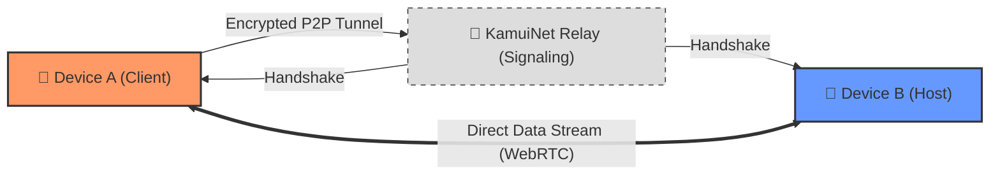

---

**KamuiNet** is an advanced P2P tunneling ecosystem designed to break geographical and network boundaries. By leveraging **WebRTC** for real-time peer-to-peer data streaming and an integrated **VPN Service**, KamuiNet creates private, encrypted tunnels directly between devices, eliminating the need for vulnerable centralized servers.

---

## 🔄 How KamuiNet Works

The magic of KamuiNet lies in our custom **P2P Tunneling Engine**. Here is how data flows from one device to another:

1.  **Handshake**: Devices discover each other through our lightweight signaling relay.
2.  **Tunneling**: Once connected, an encrypted **WebRTC** peer-to-peer connection is established.
3.  **Routing**: The `KamuiVpnService` routes all requested traffic through this secure link.

---

## 🚀 Key Features

*   **P2P Tunneling**: High-performance data routing between peers using WebRTC.
*   **Encrypted VPN Service**: System-wide secure tunnel for local network sharing.
*   **Real-time Connectivity**: Instant handshaking via custom signaling architecture.
*   **Privacy-First Design**: Zero-trust approach to data routing.
*   **Secure Pairing**: Integrated QR scanning for trusted device identification.

---

## 🛠 Technical Architecture

| Component | Technology |
| :--- | :--- |
| **Language** | Kotlin (Coroutines, Flow) |
| **P2P Engine** | WebRTC |
| **Networking** | Ktor, OkHttp |
| **Backend** | Supabase (Auth, Realtime, Functions) |
| **DI** | Hilt |
| **Persistence** | Room Database |
| **Security** | Android Security Crypto Library |

---

## 📜 Development History & Evolution

KamuiNet has evolved through rigorous engineering cycles focusing on security, architectural integrity, and decentralized performance. 

### 1. Foundation & Architecture
*   **Modular Design**: Implemented a scalable architecture separating `vpn`, `webrtc`, `signaling`, `router`, and `data` layers.
*   **Supabase Integration**: Established a robust backend for signaling and authentication using Ktor.
*   **DI Refinement**: Integrated Hilt for modular dependency management.

### 2. Networking & Security
*   **VPN Tunneling**: Implemented `KamuiVpnService` with system-level permissions for secure data routing.
*   **P2P Optimization**: Tuned WebRTC for low-latency streaming and NAT traversal.
*   **Security hardening**: Integrated `security-crypto` library for local data encryption and secure key handling.

### 3. Modernization & Optimization
*   **Project Hygiene**: Implemented strict `.gitignore` to exclude binary blobs, build artifacts, and development-specific temporary folders.
*   **Tooling**: Refined Gradle configuration (Kotlin 2.0.21, KSP) to ensure optimal build times and dependency stability.
*   **Documentation**: Standardized project documentation and architecture reporting for maintainability.

---

## 🛡 Why KamuiNet?

*   **No Centralized Vulnerabilities**: Peer-to-peer architecture ensures your data doesn't pass through insecure third-party middle-boxes.
*   **Performance**: Optimized for low-latency, real-time data streaming.
*   **Future-Ready**: Built on modern Android standards (API 34, Material 3, Jetpack components).

---

  
*Built for the future of decentralized networking.*

