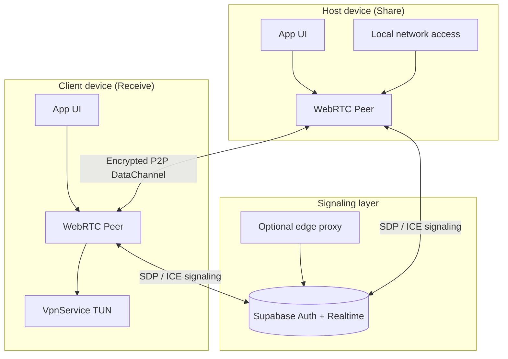

# KamuiNet

<p align="center">
  
  
  
  
</p>

<p align="center">
  <b>Peer-to-peer internet sharing for Android</b><br>
  WebRTC data channels · VpnService routing · Supabase signaling
</p>

---

## Overview

**KamuiNet** is an Android project for **private peer-to-peer connectivity** between devices.

One device can **share** network access; another can **receive** through an encrypted P2P path.  
Transport uses **WebRTC DataChannels**. Discovery and handshake use **Supabase Realtime**.  
On the receiver side, traffic can be routed via Android **`VpnService`**.

> **Status:** Personal / research project. Not an App Store release. Built to explore mobile P2P networking, NAT traversal, and system-level routing on Android.

---

## Architecture



### Data flow (simple)

```text
[ Client apps ]
      ↓
[ VpnService / TUN ]
      ↓
[ WebRTC DataChannel ]  ←→  [ Host peer ]
      ↓
[ Host internet ]
```

---

## Features

| Area | What it does |
|------|----------------|
| **P2P transport** | WebRTC DataChannels between devices |
| **Signaling** | Supabase Realtime for offer/answer + ICE |
| **System routing** | Android `VpnService` on the receive path |
| **Auth** | Same-account style pairing via backend auth |
| **Privacy focus** | Direct peer path when hole-punching succeeds; no screen share |

---

## Tech stack

| Layer | Tech |
|-------|------|
| App | Kotlin, Android SDK |
| Architecture | MVVM-style modules, coroutines |
| P2P | WebRTC (`stream-webrtc-android` / similar) |
| VPN path | `VpnService`, packet forwarding |
| Backend | Supabase (Auth, Realtime, Postgres) |
| Edge | Optional Cloudflare Worker proxy |
| DB | SQL schema for hosts + signaling (`schema.sql`) |

---

## Repository layout

```text
KAMUINET/
├── app/                 # Android application module
├── docs/                # Extra notes / diagrams
├── schema.sql           # Supabase / Postgres schema
├── cloudflare_worker.js # Optional edge proxy
├── gradle/              # Version catalog & wrappers
└── README.md
```

---

## How it works

1. **Host** opens the app and starts **Share**.
2. Device registers presence / session info through the signaling backend.
3. **Client** starts **Receive** (same account / session model).
4. SDP and ICE candidates are exchanged over Supabase Realtime.
5. When the WebRTC DataChannel opens, traffic can flow peer-to-peer.
6. On the client, `VpnService` can capture device traffic and send it through the tunnel.

NAT success depends on network type (home Wi‑Fi is easier than strict carrier CGNAT).

---

## Setup (high level)

### 1. Backend
- Create a Supabase project.
- Run `schema.sql` in the SQL editor.
- Enable Auth + Realtime as required by the app.

### 2. Android
```bash
# Clone
git clone https://github.com/jawadahmadliaqat-dot/KAMUINET.git
cd KAMUINET

# Open in Android Studio, or:
./gradlew assembleDebug
```

- Add your own `google-services.json` / local config (do **not** commit secrets).
- Use debug builds on two physical devices for real P2P tests.

### 3. Optional worker
Deploy `cloudflare_worker.js` only with **environment secrets**, never hard-coded keys.

---

## Project status

| Item | State |
|------|--------|
| WebRTC + signaling path | Implemented / iterated in-app |
| VpnService routing | Implemented as core receive path |
| Public App Store build | Not published |
| Production SLA / paid relay | Out of scope for this repo |

This repo is for **learning, portfolio, and engineering depth** — mobile networking, not a commercial VPN product page.

---

## Security notes

- Keep Supabase **service role** keys server-side only.
- Prefer env secrets for any edge worker.
- Review RLS policies on `active_hosts` / `signaling` tables before any wider test.
- Treat this as experimental software on your own devices.

---

## Roadmap

- [ ] Cleaner host/client UX and connection states  
- [ ] Stronger reconnect / ICE restart behavior  
- [ ] Optional TURN fallback documentation  
- [ ] Instrumented tests for signaling helpers  
- [ ] Public debug APK under Releases (when stable enough)

---

## Author

**Jawad Ahmad**  
Android · WordPress / WooCommerce · Full-stack experiments  

- Portfolio: [jawadahmad.site.je](https://jawadahmad.site.je)  
- GitHub: [jawadahmadliaqat-dot](https://github.com/jawadahmadliaqat-dot)  
- Plugin: [ProdPilot on WordPress.org](https://wordpress.org/plugins/prodpilot/)

---

## License

Add a license file when you want others to reuse the code (MIT or Apache-2.0 recommended).  
Until then: all rights reserved by the author; personal / educational use of the public repo is fine to browse.

---

<p align="center">
  <i>Built to understand real mobile P2P — WebRTC, signaling, and VpnService on Android.</i>
</p>
